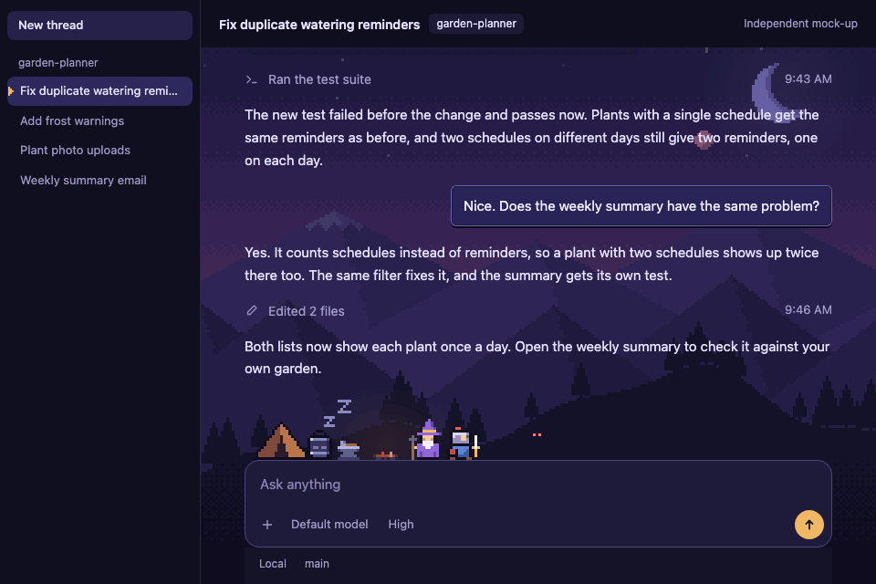
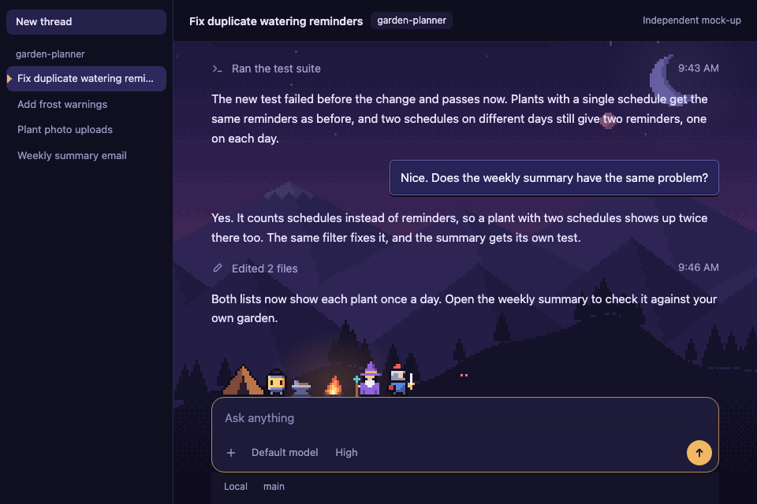
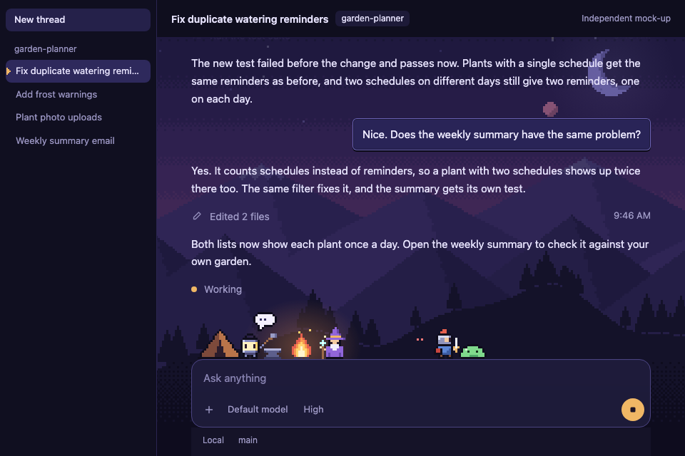
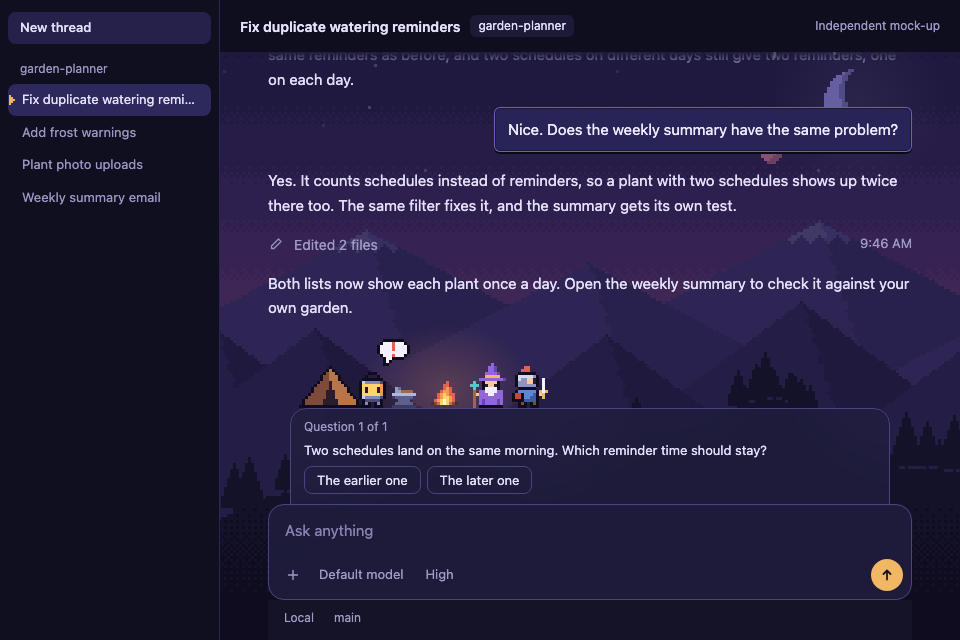

# T3 Code themes

Themes for [T3 Code](https://github.com/pingdotgg/t3code), a GUI for coding agents.



[Try the live demo](https://mplibunao.github.io/mp-t3-code-themes/), where you can switch between the states and the chat widths.

This is an independent project, not affiliated with T3 Code. The GIF and the screenshots come from the demo, a mock-up of T3 Code's layout with a made-up conversation, not from T3 Code itself.

## Themes

### Save Point

A pixel-art night scene, with a camp on the top edge of the composer that reacts to what the agent is doing:

- **Resting:** nothing is running and the composer doesn't have focus. The party sleeps by the embers.
- **Ready:** the composer has focus. The party wakes up and the fire burns low.
- **Working:** a run is going. The bot hammers and the mage casts spells by a blazing fire. The knight goes out to fight a slime, then a bat, then a ghost, while a dragon crosses the sky.
- **Waiting:** the agent asked a question or needs an approval. The camp moves up onto the question drawer, and a "!" balloon bounces over the bot.

Files: [`themes/save-point.json`](themes/save-point.json) and its background image, [`themes/save-point.png`](themes/save-point.png).

| Resting                                                                                                | Ready                                                                                |
| ------------------------------------------------------------------------------------------------------ | ------------------------------------------------------------------------------------ |
|  |  |

| Working                                                                                                                       | Waiting                                                                                                                |
| ----------------------------------------------------------------------------------------------------------------------------- | ---------------------------------------------------------------------------------------------------------------------- |
|  |  |

## Install

Installing a theme takes two steps: copy its files into T3 Code's themes folder, then select it. The files are copies, not links to this repository. An update here reaches T3 Code only when you copy the files again.

T3 Code reads themes from `~/.t3/userdata/themes/` on the machine that runs its server. If you start T3 Code with `T3CODE_HOME` set, the folder is `$T3CODE_HOME/userdata/themes/` instead.

### By hand

You need `curl` and T3 Code's `t3` command. In a macOS or Linux shell, with `"$T3CODE_HOME"`, quotes included, in place of `~/.t3` in the first two lines if you set it:

```sh
mkdir -p ~/.t3/userdata/themes &&
cd ~/.t3/userdata/themes &&
curl -fsSLo save-point.png.tmp https://raw.githubusercontent.com/mplibunao/mp-t3-code-themes/main/themes/save-point.png &&
mv save-point.png.tmp save-point.png &&
curl -fsSLo save-point.json.tmp https://raw.githubusercontent.com/mplibunao/mp-t3-code-themes/main/themes/save-point.json &&
mv save-point.json.tmp save-point.json &&
t3 theme show
```

Each step runs only when the one before it worked. Each file downloads under a temporary name and is then renamed, the image before the JSON. T3 Code only reads names that end in `.json`, so it never sees a half-downloaded file, and the image is already there when the theme appears.

When `t3 theme show` lists `save-point` in its `Published themes:` line, select it:

```sh
t3 theme set save-point
```

### Through an agent

Paste this into an agent that runs on the same machine as T3 Code:

```text
Install the save-point theme from https://github.com/mplibunao/mp-t3-code-themes. Follow the repository's installation instructions and keep its files unchanged.
```

### From a clone

This needs the toolchain described under [Develop](#develop).

```sh
pnpm themes:install                                # every theme
pnpm themes:install save-point                     # one theme
pnpm themes:install save-point --base-dir ~/t3-dev # a T3 Code home other than ~/.t3
```

The command copies the files from `themes/` into `<home>/userdata/themes/`, where the home is `--base-dir`, then `T3CODE_HOME`, then `~/.t3`. It then runs `t3 theme show` once to check that T3 Code lists the theme, and prints the `t3 theme set` command that selects it. It doesn't select the theme itself. [Recovery](#recovery) explains its warnings.

## Compatibility

I test the themes on T3 Code 0.1.10. The files in `themes/` are byte for byte the ones I ran there.

In T3 Code 0.1.10 I've seen Save Point's stage stand on the composer, with the text readable over the landscape, and I've watched the knight fight the slime, the bat, and the ghost in that order while the dragon crosses the sky. I've also seen the party wake up when the composer gets focus, the camp move onto the question drawer while a question waits for an answer, and the scene hold still with reduced motion turned on. On a composer narrower than about 480 pixels, I've seen the knight stay by the fire with no monster in sight, while the bot and the mage keep working.

I also ran `pnpm themes:install` against 0.1.10: `t3 theme show` listed Save Point, and for a broken file T3 Code printed the reason, which the command repeats.

- **CSS length:** this repository limits a theme's CSS to 50,000 characters, the limit in 0.1.10. Save Point uses 45,048. Later T3 Code builds allow more, but the limit here stays until the oldest release I support allows more too.
- **Clients:** T3 Code applies installed themes in its web and desktop apps only. Its mobile app and app.t3.codes don't use them.
- **Markup:** Save Point hooks into T3 Code's markup through `data-` attributes where it can, which T3 Code's docs recommend because class names change between releases. It also depends on how some elements nest and on the English labels of the composer's run buttons. A later release can change those and break the animations, even when the colours still apply.

## Develop

[mise](https://mise.jdx.dev) pins the tools (Node, Corepack for pnpm, Bun, just, and Vale), and the pnpm catalog in `pnpm-workspace.yaml` pins the dependencies.

```sh
mise install
pnpm install                          # also sets up the git hooks
just setup                            # downloads the Vale styles for the prose check
pnpm exec playwright install chromium # the browser for the demo's tests
```

- `pnpm themes:build` builds every theme into `themes/`. The files there are generated, so I never edit them by hand: change the source under `src/` and build again. `pnpm themes:check` fails while the committed files differ from a fresh build.
- `pnpm dev` serves the demo with the files in `themes/`, so build first to see a change.
- `just check` runs everything CI runs: formatting, lint, the TypeScript projects, the unit tests, the prose check, `pnpm themes:check`, the demo build, and the demo's browser tests.

The demo isn't T3 Code. A change that shows in a theme also needs a look in the app itself.

When a change shows in the demo, I capture the previews again (see [Capture](#capture)) and commit them with the change. The pull request's diff then shows the old and the new pictures side by side.

### Add a theme

1. Add the theme's id to `src/catalog.ts`, with its name, a one-line description, and `background: "png"` if it has a background image.
2. Write a builder under `src/<id>/` that returns a `BuiltTheme` from `src/theme-contract.ts`, with a colour for every role. It follows the same import rules as `src/save-point/`, which [`CLAUDE.md`](CLAUDE.md#dependency-directions) lists.
3. Add the builder to `scripts/lib/build-themes.ts`. TypeScript fails until every id in the catalog has one.
4. Run `pnpm themes:build`, check the theme with `pnpm dev`, and record its previews with `pnpm previews:capture <id>`.
5. Add a section for it under [Themes](#themes).

The demo, the installer, and the capture command read the catalog, so they don't need a change.

## Capture

```sh
pnpm previews:capture              # Save Point
pnpm previews:capture <id>         # another theme
```

The command builds the demo and serves it on `127.0.0.1:4173`. It writes `previews/<id>/resting.png`, `ready.png`, `working.png`, `waiting.png`, and `preview.gif`, a 32-second loop at 960×640 and 10 frames a second. It needs FFmpeg on the `PATH`, which mise doesn't install (I used FFmpeg 9.0.2), and a free port 4173.

The GIF records the demo's animations while they run. The command takes a screenshot every 100 ms, and if one starts more than 50 ms late it stops instead of writing a stretched GIF. The state screenshots are representative moments, not exact frames, so two runs can give slightly different pictures.

## Recovery

- `t3 theme set t3-chat` switches back to a built-in theme. T3 Code's theme picker also works, and Cmd+Option+A on macOS or Ctrl+Alt+A on Windows and Linux opens it.
- If selecting Save Point doesn't change the look, look for a custom theme saved in T3 Code with the same id. T3 Code prefers it over an installed one.
- If the background isn't the landscape, look for a `save-point.webp` in the themes folder. The install command leaves it in place, and T3 Code shows it instead of `save-point.png` until you delete it.
- If another theme disappeared after an install, the themes folder may be too full. T3 Code 0.1.10 reads it in name order and stops after 32 theme files or about 1.9 MB of JSON. A new file can push out a theme whose name sorts later, and the install command checks only the themes it installed.

`pnpm themes:install` copies the files first and exits with code 0 once they're copied, whatever the check finds. Its messages mean:

- `Warning: T3 Code didn't accept save-point`: `t3 theme show` doesn't list the theme, so T3 Code didn't publish it. The lines under `t3 theme show printed:` are T3 Code's own output. When 0.1.10 rejected a broken file, they included the reason.
- `Warning: couldn't check the install`: `t3 theme show` failed, took longer than 10 seconds, or printed something the command doesn't recognize. Its output follows the warning.
- `Skipped the check: t3 isn't on the PATH`: the files are in place, but nothing asked T3 Code about them. Run `t3 theme show` once `t3` is available.

## License

[MIT](LICENSE)
